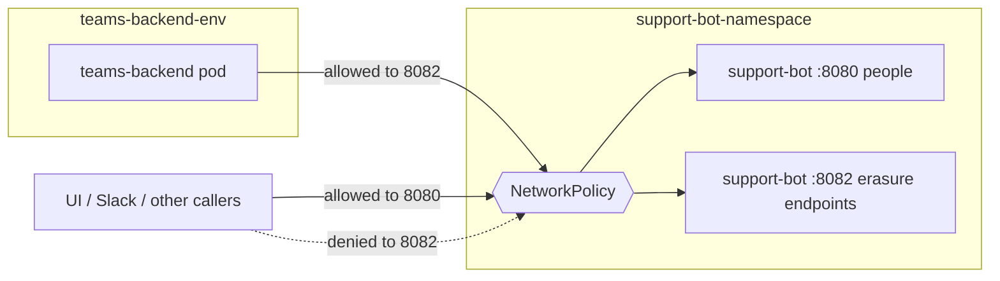

# ADR: Elevate Service Caller on an Internal Port

**Date:** 2026-10-15
**Status:** Accepted

---

## Context

[ADR-009](adr-009-personal-data-erasure-requests-from-elevate.md) gives Support Bot an erasure endpoint pair that Elevate's erasure orchestrator calls from a timer, with no person on the request. Every Support Bot endpoint today is reached by a person: they sign in through the configured OIDC provider and Support Bot mints its own JWT, or — for `/slack/events` — Slack signs the request. Neither proves a scheduled backend caller. Elevate's ADR-0068 decided how its own services trust that orchestrator; this ADR decides it for Support Bot.

Constraints:

- Elevate's services and Support Bot's API run as pods in a Kubernetes cluster and reach one another by cluster DNS over plain HTTP; nothing between pods authenticates the connection.
- Where the cluster enforces NetworkPolicy, namespace names are assigned by the API server, so a policy keyed on the caller's namespace cannot be spoofed by another tenant of the cluster.
- The orchestrator sends no credential: it calls every participant with nothing but an `X-Elevate-Tenant-Id` header.
- Support Bot is a published image and Helm chart. Most deployments have no Elevate to call them, so the endpoint must not exist unless a deployer opts in.
- Support Bot must tell this caller from a person and confine it to the erasure endpoints.
- Local development has no cluster and no NetworkPolicy.

---

## Affected Personas

- **Support Bot deployers**: opt in through Helm values, naming the namespace and pods allowed to call; nothing changes for deployers who do not.
- **Elevate operators**: point the orchestrator at Support Bot's internal Service port once processing ships.
- **Support engineers and tenants**: no change; the public port refuses the erasure endpoints to everyone.

---

## Decision Drivers

- No credential to issue, store, rotate or exchange in either system.
- No new trust relationship between Support Bot and Elevate's identity provider for a path people never use.
- Support Bot, not a third party, decides who may reach its service endpoints.
- Matching what Elevate's own services do, so the orchestrator needs no Support Bot-specific client.
- Local development keeps working.

---

## Options Considered

### Option 1 — Elevate Keycloak client credentials with a shared client secret

The orchestrator is a confidential Keycloak client exchanging a secret for an access token, which Support Bot validates against Elevate's realm.

**Pros.** A standard OAuth flow; identical in every environment.

**Cons.** Support Bot gains a second trust root beside its own JWTs, tied to one Elevate realm. A long-lived secret per environment must be generated, distributed and rotated. Keycloak becomes a runtime dependency of every call. The orchestrator would need a Support Bot-specific client, because it sends no credential to any other participant.

### Option 2 — Elevate Keycloak client credentials with a federated Kubernetes identity

As Option 1, but the orchestrator's credential is its Kubernetes service-account token, which Keycloak verifies against the cluster.

**Pros.** No secret in deployed environments.

**Cons.** Everything in Option 1 except the secret, plus a Kubernetes trust relationship and per-environment client configuration in Elevate's identity provider.

### Option 3 — Support Bot trusts the Kubernetes issuer directly

The orchestrator presents a projected service-account token, audience-bound to Support Bot, and Support Bot trusts the cluster's issuer with an allow-list of workload subjects.

**Pros.** No secret and no identity-provider change; Support Bot owns the trust decision; identity per request.

**Cons.** Support Bot gains a second trust root, a claim-rule set and a per-environment allow-list, and a separate token shape for local development. The orchestrator would again need a Support Bot-specific client.

### Option 4 — Network-layer trust: a dedicated internal port and a NetworkPolicy

Support Bot serves the erasure endpoints on a second listener, exposed as a cluster Service port and never through ingress. A NetworkPolicy on Support Bot's API pods leaves the public and management ports open to everyone, as today, and admits the internal port only from the orchestrator's pods in the orchestrator's namespace. A request arriving on the internal port is treated as a service caller because the network already established who can reach it.

**Pros.** Nothing to issue, store, rotate or validate; no identity-provider change. The caller list is a Kubernetes object deployed with Support Bot. The application only needs to recognise its own internal port. The orchestrator calls Support Bot exactly as it calls Elevate's services.

**Cons.** Identity is coarse and implicit: Support Bot knows a request came from a pod the policy admits, not which workload sent it, so the service principal holds only a source address rather than a name. A NetworkPolicy allows a port, not a path, which is why the erasure endpoints need their own listener. Local development has no NetworkPolicy, so the internal port is open on a laptop. The guarantee holds only while the cluster enforces NetworkPolicy and the orchestrator runs in the same cluster.

---

## Decision

Option 4, matching Elevate's ADR-0068.

- The internal port is **off by default**. A deployer turns it on through the Helm chart's `internalPort` values, which also carry the port (8082 by default) and the NetworkPolicy peers allowed to call it.
- When it is on, the chart exposes the port on the Service, which must then be `ClusterIP`, and always renders a NetworkPolicy that leaves the `http` and `metrics` ports open and admits the internal port only from the listed peers. The chart refuses an empty peer list.
- A request on the internal port is a **service principal**: it holds the synthetic authority `elevate:principal:service`, which no person's token can carry, and is confined to the erasure endpoints. Every other path on the internal port is refused. It carries no credential.
- The public port refuses the erasure endpoints to everyone, people included, whether or not the internal port is on.
- Support Bot **ignores** `X-Elevate-Tenant-Id`. It serves one organisation per deployment, so there is no tenant to scope a request to. Nothing on either port reads the header, so Support Bot accepts requests raised in every Elevate tenant ([ADR-009](adr-009-personal-data-erasure-requests-from-elevate.md) records the consequence).

---

## Consequences

### Positive

- No secret in any environment and no new trust root in Support Bot.
- Deployments without Elevate are unaffected: no listener, no Service port, no policy.
- Elevate's orchestrator needs only Support Bot's internal Service URL.

### Negative / Trade-offs

- Identity is network-derived and coarse.
- Turning off NetworkPolicy enforcement, or running Support Bot in a different cluster from the orchestrator, opens the internal port to whatever can reach it; Support Bot cannot detect either.
- Adding another service caller means editing the peer list in Support Bot's values.
- On a laptop the internal port is open to anything that can reach it.

### Neutral

- If per-caller identity or encryption between pods is later required, that is a service mesh or mTLS decision that replaces this record.
