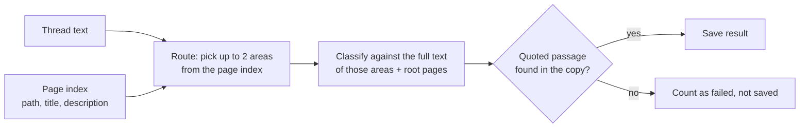

## Context

The bot already classifies closed tickets with an LLM (ADR-002). `ThreadsAwaitingAnalysisService`
finds closed tickets in a window with no `analysis` row for the in-use prompt; `AnalysisService`
classifies them one at a time, saves each result as it goes, and resumes after a restart using
an `async_job` row. `GET /summary` starts that backfill for the requested window and reports
progress. Prompts live in `analysis_prompt`, versioned per type.

The documentation this feature was sized against is about 480 pages and 2.2 MB of text, roughly
550–650k tokens, in about 20 product areas. The largest area is roughly 130k tokens; most are
under 35k. Every page has `title` and `description` frontmatter.

## Goals / Non-Goals

**Goals:**

- Reuse the existing run, resume and prompt-versioning patterns.
- Make every verdict checkable by a person.
- Keep a wrong `missing` verdict unlikely, because it sends someone to write a page that exists.

**Non-Goals:**

- A general retrieval or embedding index.
- Support for documentation too large to route by product area.

## Decisions

Fixed by the proposal and not revisited here: the four classifications; reuse of the existing
LLM ticket analysis; a page under Support Summary whose visit starts the run, with no scheduled
job; one GitHub repository, fetched only when the local copy is absent or was fetched more than
24 hours ago.

### 1. Results live in a new `doc_analysis` table

One row per ticket, replaced when the ticket is re-classified. As for `analysis`, a ticket is
analysed when its row has the current `prompt_id`. A failed attempt is recorded on the same row,
with no classification, so the run can leave the ticket alone until the retry delay has passed.

| Column | Purpose |
|---|---|
| `ticket_id` (unique) | The ticket |
| `classification` | `correct`, `missing`, `incorrect`, `not_applicable` |
| `prompt_id` | Digest of the two in-use prompts; decides whether the row is current |
| `docs_commit_sha` | The documentation version the verdict was made against |
| `failed_at`, `failure_reason` | Set instead of a classification when the attempt failed |
| `question`, `answer_summary` | What was asked and what support answered |
| `product_areas` | The areas the ticket was routed to |
| `doc_paths`, `evidence_quote` | Pages cited and the quoted passage |
| `rationale` | One or two sentences |
| `model`, `analysed_at` | Audit |

Alternatives considered:

- *Columns on `ticket`.* Simpler to query, but it puts LLM output on the core ticket record, and
  a date flag cannot tell that a prompt change has made a result stale.
- *Columns on `analysis`*. That table's `prompt_id` belongs to the classification prompt, so the
  two features would invalidate each other's rows.

### 2. Two model calls per ticket, route then classify

The whole documentation does not fit a 200k-token model and would take most of a 1M-token one,
so each ticket is first routed to the product areas it concerns.



- The page index is built from each page's frontmatter when the copy is loaded. A page without
  frontmatter is indexed by its path and first heading.
- A product area is a top-level directory under the configured documentation path. Pages at the
  root of that path, such as an overview or glossary, are included in every classification call.
- `correct` and `incorrect` must quote a passage. The bot rejects a result whose quote is not in
  the local copy, which catches invented citations.
- An area too large for the model fails the ticket with a clear error; it is not truncated.

Alternatives considered:

- *Whole documentation in every prompt.* No routing errors, but it needs a 1M-token model and
  is slow and costly per ticket.
- *Embedding or keyword retrieval.* A retrieval miss looks exactly like a `missing` verdict, and
  it needs an index to build and store.
- *An agent with file tools.* Works at any size, but adds a tool loop the bot does not have and
  makes cost per ticket unpredictable.

### 3. The local copy lives under `/tmp`

When to fetch is in the spec. The mechanics are:

- When the copy has expired, the bot first asks GitHub for the branch's head commit. If it
  matches the copy, only the fetch time is updated.
- A fetch downloads one repository archive, keeps the documentation files, and replaces the old
  copy only after the new one is complete.
- If a refresh fails and a copy exists, the run uses that copy and logs a warning.
- A run reads the copy into memory once, so all its results have the same `docs_commit_sha`.

`/tmp` is an `emptyDir`: it survives a container restart and is lost when the pod is replaced,
after which the next run fetches again. The API runs as one replica, so there is one copy.

Alternative considered: storing the copy in PostgreSQL. It would survive pod replacement, but a
re-fetch is cheap, and the database would hold megabytes of documentation text.

### 4. The run has its own lock

The Support Summary refresh and the manual analysis run share the `analysis` row in `async_job`.
Documentation analysis runs for longer, so it takes a separate row. The two can then run at the
same time, each paced by `llm.request-delay`, which doubles the request rate while both run.

### 5. The endpoint follows `/summary`

`GET /documentation-analysis?from=&to=` returns the window's results and, when closed tickets in
the window lack a current result, starts a run and reports progress. The window default (the 14
days ending yesterday), the 92-day cap and the roles (leadership and support engineers) match
`/summary`, for the same reason: a reader's request starts the run.

The page does not depend on the Support Summary having been generated for the window.

### 6. Enabled by configuration, under one `documentation-analysis` block

The feature is on when `llm.provider` is not `none` and a documentation repository is
configured, as the Support Summary page is on whenever a provider is set. All of the feature's
settings sit under a new top-level `documentation-analysis` block:

```yaml
documentation-analysis:
  repository: ""              # owner/name; empty turns the feature off
  branch: main
  path: docs                  # directory holding the documentation
  file-extensions: [.md, .mdx]
  copy-location: /tmp/documentation-analysis
  max-copy-age: 24h           # fetch again when the copy is older
  max-areas-per-ticket: 2
  failure-retry-delay: 24h    # wait before a failed ticket is attempted again
```

Setting names and defaults other than the two 24-hour values are indicative.

GitHub credentials are the exception: they stay under `pr-review-tracking.github` for now, so a deployment that uses this feature without PR tracking still fills in that block.
Moving them to settings of their own is a later change. The GitHub client, built today only when
PR tracking is enabled with a GitHub repository, becomes available when either feature needs it.

## Risks / Trade-offs

- **A wrong route gives a false `missing`** → validate on real tickets before building (task 1).
- **A large product area may not fit a 200k-token model** once the thread and output are added →
  document the minimum context size.
- **First visits are slow** → progress is shown, results appear as they are saved, and the run
  resumes after a restart.
- **The proxy provider's 20-second default timeout** → document a higher value.
- **Results go stale when documentation changes** → the page shows the documentation commit and
  fetch time; re-classification on change is a later change.
- **Thread-derived text in a new table** → columns reviewed in `erasure-compliance.yaml`.
- **A ticket that can never be classified** (for example, its area is too large for the model)
  is retried once per retry delay for ever → the page counts failed tickets, so they are visible.

## Open Questions

None remain. Settled:

- No pre-filter on the existing ticket classification. Its Task Request and Product Temporary
  Issue drivers are rarely documentation questions and could skip the documentation call, but
  that would tie this feature to the other classifier having run and being right. The
  validation task records how many such tickets there are, for a later decision.
- A second, wider check of `missing` verdicts is not part of this change. The validation task
  records the false `missing` rate, which decides whether a later change adds it.
- A failed ticket is retried only after a delay; see Decision 1 and the spec.
