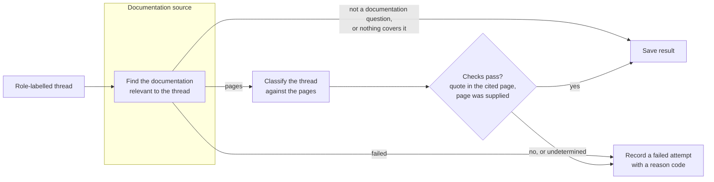

## Context

The bot already classifies closed tickets with an LLM (ADR-002). `ThreadsAwaitingAnalysisService`
finds closed tickets in a window with no `analysis` row for the in-use prompt; `AnalysisService`
classifies them one at a time, saves each result as it goes, and resumes after a restart using
an `async_job` row. `GET /summary` starts that backfill for the requested window and reports
progress. Prompts live in `analysis_prompt`, versioned per type.

This change adds a second analysis of the same tickets, in two parts. The analysis itself
classifies a ticket against documentation it is handed. A documentation source finds that
documentation. The first source reads a GitHub repository; the boundary between the two is
drawn so that another source, such as an MCP server, can replace it later (Decision 2).

The reference documentation repository used to size this feature has about 480 pages and 2.2 MB
of text, roughly 550–650k tokens, in about 20 product areas. The largest area is roughly 130k tokens; most are
under 35k. Every page has `title` and `description` frontmatter.

## Goals / Non-Goals

**Goals:**

- Reuse the existing run, resume and prompt-versioning patterns.
- Make every verdict checkable by a person.
- Keep a wrong `missing` verdict unlikely, because it sends someone to write a page that exists.
- Keep where documentation comes from apart from how tickets are classified, so the source can
  be replaced without changing the run.

**Non-Goals:**

- A general retrieval or embedding index.
- Support, in the GitHub source, for documentation too large to route by product area.
- A second documentation source. Only the boundary is built now.

## Decisions

Fixed by the proposal and not revisited here: the four classifications; reuse of the existing
LLM ticket analysis; a page under Support Summary whose visit starts the run, with no scheduled
job; one GitHub repository, fetched only when the local copy is absent or was fetched more than
24 hours ago.

### 1. Results live in a new `doc_analysis` table

One row per ticket, replaced when the ticket is re-classified. As for `analysis`, a ticket is
analysed when its row has the current `prompt_id`. A failed attempt is recorded on the same row,
with no classification, so the run can leave the ticket alone until it is due again (Decision 9).

Only rows with the current `prompt_id` are shown or counted. After a prompt or setting change,
a ticket's old row counts as not yet classified, and the next attempt replaces it whether it
succeeds or fails. The page therefore never mixes verdicts from two versions of the prompts,
at the price of showing fewer results until the window has been classified again.

| Column | Purpose |
|---|---|
| `ticket_id` (unique) | The ticket |
| `classification` | `correct`, `missing`, `incorrect`, `not_applicable` |
| `prompt_id` | Digest of the classification prompt, `max-input-tokens` and the source's fingerprint (Decision 2); decides whether the row is current |
| `source`, `docs_version` | The documentation source that supplied the context, and its version when it did; for the GitHub source, the commit |
| `failed_at`, `failure_reason` | Set instead of a classification when the attempt failed. The reason is a code from Decisions 8 and 9, never model or provider text |
| `attempts` | Failed attempts under the current `prompt_id` |
| `question`, `answer_summary` | What was asked, as distilled by the source when it gives one and by the classification call otherwise, and what support answered |
| `tags` | Up to five topic tags for the question, kept so that a later change can search earlier tickets |
| `product_areas` | The areas the source consulted, when the source has areas |
| `doc_paths`, `evidence_quote` | For `correct` and `incorrect`, the one page cited and the quoted passage. For `missing`, the closest pages, if any, and no quote |
| `rationale` | One or two sentences |
| `model`, `analysed_at` | Audit |

Alternatives considered:

- *Columns on `ticket`.* Simpler to query, but it puts LLM output on the core ticket record, and
  a date flag cannot tell that a prompt change has made a result stale.
- *Columns on `analysis`*. That table's `prompt_id` belongs to the classification prompt, so the
  two features would invalidate each other's rows.

### 2. The run asks a documentation source for context

The work has two parts with one boundary between them.

- **The analysis** fetches a ticket and its thread, obtains the relevant documentation,
  classifies, checks the answer and saves it. It does not know where documentation comes from.
- **A documentation source** answers one question: which documentation is relevant to this
  thread? Everything about finding it is inside the source. The first source reads a GitHub
  repository (Decisions 3 and 12): it keeps a copy, builds a page index and asks the model which
  product areas to read. A later source might ask an MCP server instead. Replacing the source
  changes nothing in the analysis.



What each outcome leads to is in Decision 8.

The boundary is four operations:

| The analysis asks | The source answers |
|---|---|
| `open()`, once at the start of a run | A session for the run, or that the source is unavailable and why. This is where a source refreshes whatever it keeps |
| `version()`, on the session | A string recorded with each result. Its meaning belongs to the source; for the GitHub source it is the commit |
| `findContext(thread, budget)`, on the session, once per ticket | One of four answers. **Pages**: the text to classify against, each with an identifier and, where the source has areas, the area it belongs to, plus the names of areas that exist and were not supplied. **Nothing covers it**, with a reason. **Not a documentation question**, with a reason. **Failed**, with a reason code and whether trying again could help |
| `fingerprint()` | A value that changes whenever the source would answer the same question differently: its type, its prompts and its settings that change results |

The rules that keep the source replaceable:

- A source is given the thread and nothing else about the ticket. No model call comes before
  it, so the analysis adds no prompt of its own ahead of the source's.
- A source that looks at the thread anyway may also say what was asked and whether it is a
  documentation question. The GitHub source does both in its routing call (Decision 12), which
  ends tickets that are not documentation questions without the classification call. Neither
  is required of a source: the classification call makes the same judgement and distils the
  question when the source has not. An answer that ends a ticket without classification must
  carry the question, since nothing later will supply it.
- Topic tags travel with the question: a source that states the question gives its tags too,
  and otherwise the classification call gives both.
- `budget` is the most text a source may return, as estimated tokens: `max-input-tokens` less
  the thread and the prompt. How it stays inside is the source's business. The analysis checks
  the answer and fails the ticket if it is over.
- A source may call the model itself. It uses the same client, pacing and handling of provider
  failures as the analysis (Decision 9), and the same wrapping of data (Decision 10).
- The analysis checks a result against the pages the source returned, never against anything
  the source holds.
- `prompt_id` is the digest of the classification prompt, `max-input-tokens` and the source's
  fingerprint. Changing the source, or a setting of it that changes results, makes
  results stale the way a prompt change does.
- One source is active at a time, chosen by configuration (Decision 6).
- In code, the analysis and the boundary sit in one package and each source in a package of
  its own. Nothing outside a source's package refers to its types, and a test enforces it.

The checks on a result, which are the same for every source:

- `correct` and `incorrect` must cite one page and quote a passage of at most 200 characters
  from it. The bot rejects the result unless the cited page was among those the source returned
  and contains the quote. Both texts are compared after collapsing whitespace and removing
  markdown emphasis markers (`*`, `_`, `` ` ``), so a quote that spans a wrapped line still
  matches. This catches invented citations without discarding honest ones over formatting.
- A rejected result is a failed attempt, recorded like any other (Decision 1). Only `correct`
  and `incorrect` can be rejected this way, so a high rejection rate would tilt the page's
  counts towards `missing` and `not_applicable`. Validation measures it.

Alternatives considered:

- *Routing inside the analysis*, with a source that only supplies files. It saves nothing, and
  routing by page index is one way of finding context, particular to documentation held as
  files. A source that searches has no use for it, so adding one would mean changing the run.
- *A triage call in the analysis*, ahead of the source, to distil the question and decide
  whether it is a documentation question. Every source would then receive the same distilled
  question. It adds a prompt and a model call to every ticket, and the GitHub source's routing
  call reads the thread anyway, so it does this work at no extra cost.

### 3. The GitHub source keeps its copy under `/tmp`

This is what the GitHub source does when the run opens it. When to fetch is in the spec. The
mechanics are:

- When the copy has expired, the bot first asks GitHub for the branch's head commit. If it
  matches the copy, only the fetch time is updated.
- A fetch downloads one repository archive and replaces the old copy only after the new one is
  complete.
- The archive is read as a stream. Only regular files under the configured path with a
  configured extension are written. An entry that is a link, or whose path is absolute or
  contains `..`, is skipped. The fetch fails if the kept files exceed `max-copy-size` or
  `max-files`, so a wrong repository or a hostile archive cannot fill the pod's disk.
- If a refresh fails and a copy exists, the run uses that copy and logs a warning.
- A run reads the copy into memory once, so all the results of an uninterrupted run have the
  same `docs_version`. A run resumed after a restart reads the copy again, and after a pod
  replacement fetches it again, so it may continue on a newer version. Each result records the
  version it used, so nothing is lost by this, and pinning a resumed run to an old commit is
  not worth a second fetch path.

`/tmp` is an `emptyDir`: it survives a container restart and is lost when the pod is replaced,
after which the next run fetches again. The API runs as one replica, so there is one copy.

Alternative considered: storing the copy in PostgreSQL. It would survive pod replacement, but a
re-fetch is cheap, and the database would hold megabytes of documentation text.

### 4. The run has its own lock and its own worker

Two things keep today's LLM runs apart. The Support Summary refresh and the manual analysis run
share the `analysis` row in `async_job`, and both are handed to `analysisTaskExecutor`, which
has one thread and no queue, so a second job is rejected rather than queued.

Documentation analysis runs for much longer than either, so it gets its own of both:

- its own `async_job` row, so its lock is independent;
- its own executor, also one thread and no queue, created only when the feature is enabled.

A documentation run and one existing analysis job can then be active together. Within each,
calls stay sequential and paced by `llm.request-delay`. At most two LLM jobs run at once, never
two of the same kind.

This departs from ADR-002, which keeps LLM calls sequential to avoid provider rate limits, and
from the existing code's rule that analysis runs never overlap on the LLM. ADR-012 records the
change.

Alternative considered: one shared lock, with the runs taking turns. It needs no ADR and cannot
raise the request rate, but a Support Summary refresh would wait behind a documentation run for
as long as it takes, which on a first visit to a busy window is far longer than the refresh
itself. Holding up an existing page for a new one is the worse outcome.

### 5. The endpoint follows `/summary`

`GET /documentation-analysis?from=&to=` returns the window's results and, when closed tickets in
the window lack a current result, starts a run and reports progress. The window default (the 14
days ending yesterday), the 92-day cap and the roles (leadership and support engineers) match
`/summary`, for the same reason: a reader's request starts the run. The page reuses the Support
Summary page's window picker, so it opens on the same window as that page, the two business
weeks before the current one, and sends it explicitly.

The page does not depend on the Support Summary having been generated for the window.

### 6. Enabled by configuration, under one `documentation-analysis` block

The feature is off by default. It is on when `documentation-analysis.enabled` is true and
`llm.provider` is not `none`. Unlike the Support Summary page, which is on whenever a provider
is set, this feature spends enough per ticket to deserve its own switch. All of the feature's
settings sit under a new top-level `documentation-analysis` block. The analysis's settings are
at its top; each source's settings are under `source`, so adding a source adds a block and
changes none of the others:

```yaml
documentation-analysis:
  enabled: false
  max-input-tokens: 150000    # estimated size limit of one classification call
  max-tickets-per-day: 500    # tickets attempted in any 24 hours
  failure-retry-delay: 24h    # wait before a failed ticket is attempted again
  max-attempts: 3             # failed attempts before a ticket waits for a prompt or setting change
  run-retry-delay: 15m        # wait before a run starts again after the provider stopped one
  source:
    type: github              # which source supplies the documentation; the only one for now
    github:
      repository: ""          # owner/name; required when this source is selected
      branch: main
      path: docs              # directory holding the documentation
      file-extensions: [.md, .mdx]
      copy-location: /tmp/documentation-analysis
      max-copy-age: 24h       # fetch again when the copy is older
      max-copy-size: 50MB     # a fetch that keeps more than this fails
      max-files: 5000         # a fetch that keeps more files than this fails
      max-areas-per-ticket: 2
```

Setting names and defaults other than the two 24-hour values are indicative.

GitHub credentials are the exception: they stay under `pr-review-tracking.github` for now, so a
deployment that uses the GitHub source without PR tracking still fills in that block. Moving
them to settings of their own is a later change. The GitHub client, built today only when PR
tracking is enabled with a GitHub repository, becomes available when either feature needs it.

That block is validated today only when PR tracking is enabled and has a GitHub repository, so
with PR tracking off a blank token would pass startup and fail on the first fetch. When the
feature is enabled with the GitHub source, startup fails with a message naming the setting if
the repository is blank or the block holds no usable credentials.

### 7. Each thread message carries a role label

`ThreadService.getThreadAsText` returns message texts with no author, so the model would have to
guess which message is support's answer. `incorrect` depends on that answer, so the bot labels
each message itself, from what Slack already returns with the thread:

| Label | Rule, first match wins |
|---|---|
| `[bot]` | The message has a bot id |
| `[tenant]` | The author raised the ticket (posted the thread's first message) |
| `[support]` | The author is a member of the support team (`SupportTeamService.isMemberByUserId`) |
| `[tenant]` | Anyone else |

- A new `ThreadService` method builds this text. `getThreadAsText` is unchanged, so the existing
  classifier's input and results are unaffected.
- The label is added after sanitisation (ADR-005). Sanitisation collapses each message to one
  line, so message text cannot forge a label at the start of a message.
- No names or user ids are sent. The label is the only author information the model sees.
- The bot decides whether a thread has a support answer by the presence of a `[support]`
  message, and does not save an `incorrect` result for a thread that has none.
- `SentimentService` already splits a thread's messages into support and others the same way.

Known limits, accepted:

- Membership is the support team as it is when the run happens. A message from someone who has
  since left the team is labelled `[tenant]`. Its effect shows in Validation, as contradictions
  the bot misses.
- A support engineer who raises a ticket is the tenant in that thread.
- An answer from someone outside the support team is labelled `[tenant]` and does not count as
  support's answer.

### 8. Every outcome is defined

| Step | Answer | Outcome |
|---|---|---|
| Source | Not a documentation question | `not_applicable`, saved with the source's reason as the rationale. The classifier is not called |
| Source | Nothing covers the question | `missing`, with no areas and the source's reason as the rationale. The classifier is not called |
| Source | Failed | Failed, with the source's code. For the GitHub source: `unknown_area`, `area_too_large` (Decision 12) |
| Source | More text than the budget | Failed, `context_too_large` |
| Source | Pages | The classifier is called |
| Classification | One of the four classifications, checks pass | Saved |
| Classification | `correct` or `incorrect`, quote check fails | Failed, `quote_not_found` |
| Classification | A cited or closest page that the source did not return | Failed, `unknown_page` |
| Classification | `incorrect`, thread has no `[support]` message | Failed, `no_support_answer` |
| Classification | `undetermined` | Failed, `undetermined` |
| Any call | Not readable, an answer outside the allowed set, or a broken contract (Decision 10) | Failed, `invalid_response` |
| Any call | The provider call fails after its retries (Decision 9) | Failed, `provider_error` |

- `undetermined` is for the classifier to say the pages it was given are the wrong ones: the
  question belongs to a part of the documentation it was not given, or the thread is too
  unclear to judge. A source that has areas names the ones it did not supply, so the classifier
  can tell. Without this a source's mistake can only come out as `missing`, the verdict this
  design most wants to keep trustworthy. It is not a fifth classification: it is stored as a
  failed attempt and counted with the failed tickets.
- A question that nothing in the documentation covers is a real gap. The source's two separate
  answers keep it apart from "not a documentation question".
- A `missing` result names the closest pages it found, in `doc_paths`. They show where the new
  page belongs, and the bot checks they were among the pages the source returned.
- The first two rows end a ticket without the classification call, the costliest one.

### 9. Failures are handled by kind, and the work is capped

| Kind | Reason code | In the run | Afterwards |
|---|---|---|---|
| Provider failure: rate limit, timeout, server or network error | `provider_error` | The call is retried up to three times, waiting longer each time and for as long as the provider asks | A failed attempt, if it still fails |
| Result failure: the model answered and the answer was rejected | The codes of Decision 8 | Not retried | A failed attempt |
| Source failure that trying again cannot help, such as `area_too_large` | The source's code | Nothing further is called | A failed attempt that is not repeated |

- A failed ticket is attempted again once `failure-retry-delay` has passed, up to
  `max-attempts` attempts. After that, and at once for a failure the source says trying again
  cannot help, it waits until the `prompt_id` changes (Decision 2).
- Five tickets in a row ending in `provider_error` mean the provider is down or the bot is
  being rate-limited, not that the tickets are bad. The run stops, the failures of that streak
  are removed so those tickets are not parked, and no run starts for `run-retry-delay`. The
  page reports the analysis as unavailable meanwhile. The stop is remembered in memory, as
  `SummaryRefreshService` remembers its failures, so a restart clears it.
- `max-tickets-per-day` caps the tickets attempted in any 24 hours, counted from the rows' own
  times. A run stops at the cap and the page says so. This is the cost limit. A cap per run
  would bound nothing, because any reader's visit starts a run and the page polls.

Alternatives considered:

- *A button that starts the run, for support engineers only.* It makes the spend a deliberate
  act, but departs from the Support Summary page's behaviour, which the proposal keeps. The
  daily cap and the `enabled` switch bound the cost without it.
- *Asking the source about every ticket first, then classifying in product-area order*, so consecutive calls
  share a documentation prefix the provider may cache. It needs a second state per ticket and a
  two-phase resume. Documentation is already placed first and in a fixed order (Decision 10),
  so neighbouring tickets in the same area benefit where the provider caches prefixes.
  Reordering is decided after task 1.2 measures the cost.

### 10. Inputs are data, and outputs are checked

What is sent:

- The classification call is laid out as documentation, then the area names, the question and
  the thread, then the instructions. Instructions come last so that nothing in the data follows
  them.
- Documentation comes first, in the order the source returned it. The GitHub source returns
  areas by name and pages by path, so calls for the same areas start with the same text.
- The thread, the question and each page are wrapped in fixed tags. Before wrapping, the bot
  removes those tag names from the text itself, so data cannot close its wrapper or open a
  false one. The quote check compares against the page as it was sent.
- The wrapping is shared code. A source that calls the model uses it for whatever it sends:
  the GitHub source's routing call is the page index and the thread, then the instructions.
- Every prompt says that everything inside the tags is data and that instructions found there
  are ignored.

Alternative considered: a random delimiter for each request. It gives the same guarantee as
removing the tag names, but makes every call's opening text different.

What comes back:

- Where the provider can constrain output to a JSON schema, the bot uses that. Otherwise it
  accepts the JSON object alone or inside a code fence.
- The bot checks the contract itself: a classification from the allowed set; for `correct` and
  `incorrect` exactly one page and a quote; for `incorrect` a summary of support's answer; every
  page among those supplied. A break is `invalid_response` unless Decision 8 gives it a more
  specific code.
- ADR-011 chose inline markup over structured output for the Support Summary, because one
  malformed answer would cost the whole summary. Here an answer is one small record for one
  ticket, a malformed one fails only that ticket, and it is tried again.
- The question is distilled once. When the source gives one, it is passed to the classification
  call and stored, so the two calls cannot disagree about what was asked. Otherwise the
  classification call distils it.
- `question`, `answer_summary`, `rationale` and `tags` are passed through the deployment's
  sanitisation patterns (ADR-005) before they are saved, behind the prompt's own writing rules.
  The quote is documentation text and is saved as it is.
- Tags are for finding the same question again: a later change can search earlier tickets by
  tag and by the stored question. The model chooses them freely, 3 to 5 for each question. The
  bot lowercases them, drops duplicates and any that are not words joined by hyphens, and keeps
  at most five. A ticket never fails over its tags; it may have none.
- Free tags drift: the same topic can be tagged in more than one way, so a search cannot rely
  on exact matches alone. The stored question is the better key, and tags help to narrow and
  group. A fixed list of tags would not drift, but someone would have to own it, so it is left
  until a search exists to show whether it is needed.

### 11. `incorrect` is shown as a conflict, and the page leads with gaps

- `incorrect` says that the documentation and support's answer disagree. It does not say which
  is right: the page may be out of date, or the answer may be. The page labels it "Conflicts
  with support's answer" and shows the passage beside the summary of the answer.
- Asking whether something is supported is a documentation question. Asking for a feature to
  be built or the platform to be changed is not, and is `not_applicable`. Otherwise every
  feature request would be reported as a missing page.
- A thread that raises several questions is classified on the first substantive one. A vague
  opening that later messages clarify is one question.
- Results are listed with `incorrect` and `missing` first and can be filtered by
  classification. `correct` and `incorrect` results are grouped by the page they cite, and
  `missing` results by product area, each with a count, so the pages and areas that draw the
  most tickets stand out.
- A ticket is counted under one area: that of the page it cites, or else the first area the
  source consulted. Tickets with no area form their own group: the gaps the source says nothing
  covers, and every ticket of a source that has no areas.
- Each result shows the documentation version it was made against, since a window can hold
  results from several. The page also shows the source's current version and when it was last
  refreshed.

### 12. The GitHub source finds context by routing to product areas

The whole documentation does not fit a 200k-token model and would take most of a 1M-token one,
so this source narrows it before returning anything.

- The page index is built from each page's frontmatter when the copy is loaded. A page without
  frontmatter is indexed by its path and first heading.
- A product area is a top-level directory under the configured documentation path. Pages at the
  root of that path, such as an overview or glossary, are returned with every answer.
- This layout is checked when the copy is loaded. A repository with every page at the root has
  no areas to route to, and one whose root pages alone exceed the budget cannot be used at all,
  so in both cases the source is unavailable, with an error that says so. An area that alone
  exceeds the budget is logged as a warning, since its tickets will fail with `area_too_large`.
- One model call, the routing call, is given the page index and the thread. It distils the
  question, decides whether it is a documentation question, and if so chooses up to
  `max-areas-per-ticket` areas, most likely first.
- If it is not a documentation question, that is the source's answer, and no pages are
  returned.
- The source returns every page of the chosen areas, plus the root pages, and names the other
  areas as not supplied.
- If the routing call chooses no area for a documentation question, the answer is "nothing
  covers it". If it names an area
  that is not in the index, the answer is a failure, `unknown_area`.
- If two areas together are over the budget, the source returns the first, which routing ranks
  most likely, and names the second as not supplied. If the first alone is over, the answer is a
  failure, `area_too_large`, that trying again cannot help. No page is ever truncated.
- Its fingerprint covers the routing prompt, `max-areas-per-ticket`, and the repository, branch
  and path. It does not cover the commit: a change to the documentation alone does not make
  results stale.

Alternatives considered:

- *Whole documentation in every prompt.* No routing errors, but it needs a 1M-token model and
  is slow and costly per ticket.
- *Embedding or keyword retrieval.* A retrieval miss looks exactly like a `missing` verdict, and
  it needs an index to build and store.
- *An agent with file tools.* Works at any size, but adds a tool loop the bot does not have and
  makes cost per ticket unpredictable.

## Validation

The feature is released only if its verdicts agree with support engineers' on real tickets. The
same measures are taken twice: by script before building (tasks 1.2 and 1.3) and from the built
feature before release (task 6.3). The labelled set is at least 150 closed tickets from at
least one month, with at least 15 in each classification, each labelled by a support engineer;
30 are labelled by a second engineer to show how far people agree with each other.

| Measure | Target |
|---|---|
| Of tickets the bot calls `missing`, the share a support engineer also calls `missing` | at least 80% |
| Of tickets a support engineer calls `missing`, the share the bot also calls `missing` | at least 70% |
| Of documentation questions, the share for which the source supplied the area the support engineer named (GitHub source) | at least 90% |
| Agreement over all four classifications | at least 80%, or the agreement between the two engineers if that is lower |
| Share of tickets ending as a failed attempt, by reason code and by the engineer's label | recorded; no more than 10% in total |
| Input tokens and seconds per ticket, for each call | recorded; replaces the estimates in the proposal's Impact |

The targets are starting values, set before the first run and changed only by editing this
table. A missed target means revising the prompts or the design and measuring again, not
releasing with a note. The table of bot verdict against engineer verdict is kept in
`validation.md` in this change, as counts only.

## Risks / Trade-offs

- **A source that supplies the wrong pages gives a false `missing`** → the classifier can answer
  `undetermined` (Decision 8), and the false `missing` rate has a target (Validation).
- **The boundary is drawn with one source built**, so a second may not fit it exactly → it is
  kept small, a question in and pages out, and was drawn with a source that searches, such as
  an MCP server, in mind. Any change it needs is confined to the boundary and the sources.
- **A large product area may not fit a 200k-token model** once the thread and output are added →
  the size is checked against the budget before the call (Decisions 2 and 12), and the runbook
  gives the minimum context size.
- **First visits are slow and costly** → progress is shown, results appear as they are saved,
  the run resumes after a restart, and the daily cap bounds the spend (Decision 9).
- **Provider timeouts are too short for a large call**: the proxy provider's default is 20
  seconds and the Anthropic provider's is 60 → the runbook gives higher values.
- **Two LLM jobs at once can exceed the provider's rate limits**, most likely its tokens per
  minute, since the documentation calls are large → a rate-limited call is retried in the run,
  and a run that keeps failing stops without parking its tickets (Decision 9); the runbook says
  which limits to check.
- **Text in a thread or a page can try to steer the verdict**, and `missing` and
  `not_applicable` need no quote, so the checks would not catch it → inputs are sent as data
  with their wrappers protected (Decision 10), and every result links to its ticket for a
  person to check.
- **Documentation content is sent to the LLM provider**, which the bot has not done before →
  stated in the proposal's Impact, for each deployment to accept before enabling.
- **Results go stale when documentation changes** → the page shows the documentation commit and
  fetch time; re-classification on change is a later change.
- **Thread-derived text in a new table** → columns reviewed in `erasure-compliance.yaml`.
- **A ticket that can never be classified** stays failed once its attempts are used up → the
  page counts failed tickets, so they are visible, and a prompt or setting change tries them
  again.

## Open Questions

None remain. Settled:

- No pre-filter on the existing ticket classification. Its Task Request and Product Temporary
  Issue drivers are rarely documentation questions and could skip the documentation call, but
  that would tie this feature to the other classifier having run and being right. The
  validation task records how many such tickets there are, for a later decision.
- A second, wider check of `missing` verdicts is not part of this change. The false `missing`
  rate measured in Validation decides whether a later change adds it.
- A failed ticket is retried only after a delay, and a limited number of times; see Decision 9
  and the spec.
- Tags are free, not taken from a fixed list; see Decision 10.
- Runs start on a visit, not from a button, and tickets are not reordered by product area;
  see the alternatives under Decision 9.
- There is no triage call ahead of the source; the source's own call covers it. See the
  alternatives under Decision 2.
